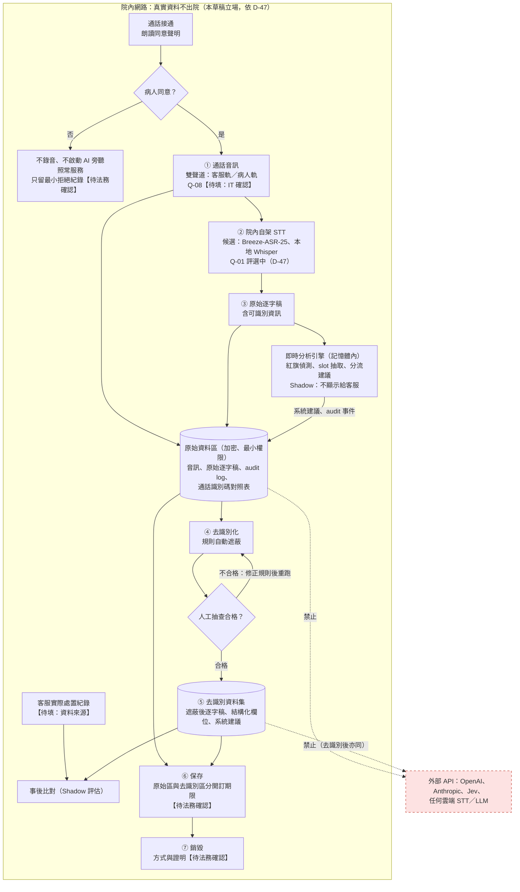

# Q-06 資料流程與保護措施（草稿）

> **草稿，供法務審閱，非法律意見。**
> 日期：2026-10-22｜版本：draft v0.1｜起草：實作端（acs_triage）｜依據：`docs/DECISIONS.md` D-10、D-47；`docs/BLUEPRINT.md` §3.1、§3.11、§7、§8
> 標記說明：【待填：…】由醫院或 IT 填寫（IT 待確認事項一律寫成【待填：IT 確認…】）；【待法務確認】由法務決定。文中加密與存取做法都是**起草建議**，不是已上線的設定。
> 本文件不含任何真實病人資料；所有範例皆為虛構。

相關文件：`Q06_通話同意聲明_草稿.md`、`Q06_待法務確認問題清單.md`（以下簡稱「問題清單」）。

---

## 0. 範圍與硬性前提

- **範圍**：Phase 1 Shadow 期間、病人已同意的通話（BLUEPRINT §7）。未同意的通話不進入本流程（見同意聲明草稿 §4）。
- **D-10**（原文）：真實病人資料在資料出境／本地部署方案確認前，不送任何外部 API。
- **D-47**：STT 只測開源、可院內自架的 MediaTek Breeze-ASR-26 與本地 Whisper，**音訊不出院**；Q-02 結案，**真實資料路徑不使用 Jev**，不進行跨境傳輸流程。（D-48 更新：Breeze 改測國語版 Breeze-ASR-25，取代台語專用的 Breeze-ASR-26）
- **BLUEPRINT §8**（原文）：真實病人資料不出院內網路，直到 Q-02／Q-06 解決。
- **本草稿的立場**（依 D-47 方向：STT 院內自架、真實資料路徑不用 Jev；不以 D-10、§8 的條件解除為前提）：真實病人資料——包括通話音訊、原始逐字稿、**去識別後的逐字稿與結構化欄位**、系統建議——**一律不送任何外部 API，包含 OpenAI、Anthropic（Claude）、Jev**，也不送任何雲端 STT 或雲端 LLM 服務。去識別後的資料仍視為真實病人資料（Q-02 原本評估過「只送去識別結構化欄位到境外」，D-47 已結案不採用）。
- **仍待決的依賴**：Q-08 能否取得雙聲道即時音訊【待填：IT 確認】；Q-01 STT 評選尚在進行。

---

## 1. 資料生命週期總覽

圖說：

- 圖中編號 ①–⑦ 對應 §2 的各步驟。
- **即時分析引擎讀的是原始逐字稿**：紅旗偵測、slot 抽取、分流建議在通話當下於院內記憶體中執行（BLUEPRINT §2、§3.3–§3.7），不等去識別化。因此即時分析的輸出在去識別前與原始逐字稿同屬可識別資料，一律存放在原始資料區。
- 去識別化發生在「存入研究與比對用的資料集之前」，不是在即時分析之前。
- 虛線「禁止」表示該路徑在設計上不存在、也不得建立。

---

## 2. 各步驟說明

每一步列出：資料內容、存放位置、誰能存取、加密（傳輸中／靜態）、記錄與稽核、待確認事項。

### ① 通話音訊

- **資料內容**：客服與病人（或代打者）的通話聲音。設計前提是雙聲道（客服一軌、病人一軌），能否取得取決於電話系統是否支援 SIPREC 或 media forking（Q-08）【待填：IT 確認電話系統型號與雙聲道支援】。若只能取得單聲道混音，說話者分辨要靠 STT，`speaker` 欄位可靠度會下降。
- **存放位置**：院內原始資料區【待填：IT 確認主機與儲存位置】。
- **誰能存取**：系統服務帳號（串流接收、STT）。人員原則上不直接聽取；例外情形（STT 品質抽查、病人申訴調查）需事先授權並留紀錄【待填：授權人員名單與核准流程】。
- **傳輸中加密（建議）**：電話系統到本系統的音訊串流使用 SRTP，或 SIPREC 搭配 TLS；串流所在網段與一般院內網路隔離【待填：IT 確認可行做法】。
- **靜態加密（建議）**：AES-256 等級的儲存加密；金鑰由院內金鑰管理（KMS 或 HSM）保管，與資料分開存放；建議每通話（或每批次）使用獨立金鑰，以便日後以「銷毀金鑰」方式銷毀【待填：IT 確認加密演算法與金鑰管理方式】。
- **記錄與稽核**：BLUEPRINT §3.11 的 audit log 目前沒有「錄音開始／停止」與「同意狀態」事件（見 §5）。人員聽取音訊的紀錄需由儲存層的存取紀錄提供【待填：IT 確認存取紀錄機制】。
- **待確認**：
  - 轉寫完成後是否保留原始音訊（立即刪除，或保留供 STT 品質評估）【待法務確認】（問題清單 Q06-05）。
  - 若客服電話系統是雲端服務，音訊在進入本系統前已經過該服務，是否構成院外處理【待法務確認】（問題清單 Q06-11、Q06-12）。

### ② 院內 STT

- **資料內容**：輸入音訊，輸出逐段文字；每段含 `text`、`speaker`、`confidence`、`lang_hint`、`t_start`、`t_end`（BLUEPRINT §3.1）。
- **存放位置**：院內自架 STT 主機（候選：Breeze-ASR-25、本地 Whisper，Q-01 評選中；D-47）【待填：IT 確認主機】。模型權重下載前須列出檔名、來源與大小請 Clinical Owner 同意（D-47）；下載後離線執行，推論時不連外。
- **誰能存取**：系統服務帳號；STT 主機管理者僅能維運系統、不讀取內容【待填：IT 確認管理者名單】。
- **傳輸中加密（建議）**：音訊從接收端送到 STT 主機走院內 TLS 1.2 以上（建議 1.3）連線【待填：IT 確認】。
- **靜態加密（建議）**：STT 盡量只在記憶體處理；若有暫存檔，加密存放並於處理完成後清除【待填：IT 確認暫存行為】。
- **記錄與稽核**：每段輸出寫入 audit log `stt_segment` 事件，並記錄 `model_version`（BLUEPRINT §3.11）。

### ③ 原始逐字稿（含即時分析）

- **資料內容**：完整逐字稿，**含可識別資訊**（姓名、電話、地址、病史敘述等）。即時分析引擎在通話當下讀取原始逐字稿，產生紅旗命中、slot 狀態、分流建議與提示題；Phase 1 這些輸出不顯示給客服（BLUEPRINT §7）。
- **存放位置**：院內原始資料區，與去識別資料集分開存放。
- **誰能存取**：系統服務帳號；資料管理者與去識別人工抽查員（人數盡量少、事先授權並簽署保密文件）【待填：名單與保密文件形式】。研究團隊原則上不接觸原始資料區。
- **傳輸中加密（建議）**：院內服務之間一律 TLS，服務帳號之間建議雙向憑證驗證（mTLS）【待填：IT 確認】。
- **靜態加密（建議）**：同 ①，建議每通話獨立金鑰【待填：IT 確認】。
- **記錄與稽核**：audit log 記錄 `stt_segment`、`redflag_hit`、`slot_update`、`tier_decision` 等事件，append-only（BLUEPRINT §3.11）。**現況發現**：Phase 0 模擬器 `sim/runner.py` 的 `stt_segment` 事件 payload 直接包含逐字稿原文；若 Phase 1 沿用此設計，**audit log 本身就是可識別資料**，且「不可刪改」與銷毀、刪除請求互相衝突（見 §5、問題清單 Q06-18）。

### ④ 去識別化

- **資料內容**：原始逐字稿與即時分析輸出，經規則遮蔽後產生去識別版本；方法與欄位見 §3。
- **存放位置**：院內去識別作業環境，與原始資料區同一受控網段、不可連外【待填：IT 確認存放位置】。
- **誰能存取**：去識別作業服務帳號；人工抽查員。
- **傳輸中／靜態加密（建議）**：同 ③；作業中間檔加密，作業完成後清除【待填：IT 確認】。
- **記錄與稽核**：建議每批次記錄：規則版本、處理筆數、抽查樣本、抽查結果、漏遮與修正紀錄【待填：IT 確認記錄位置】。現行 audit log 沒有這類事件。

### ⑤ 結構化欄位與系統建議（去識別資料集）

- **資料內容**：遮蔽後逐字稿；slot 狀態（英文 key／enum）；系統建議（紅旗命中、provisional／final tier、提示題）；`rules_version`、`model_version`；以研究代號取代通話識別碼。用途是與客服實際處置紀錄做事後比對（Phase 1 目的）。
- **存放位置**：院內研究資料區【待填：IT 確認存放位置】。
- **誰能存取**：Clinical Owner 核准的研究團隊名單【待填：名單】。
- **傳輸中／靜態加密（建議）**：同 ③【待填：IT 確認】。
- **記錄與稽核**：研究資料區的存取與匯出紀錄（誰、何時、查了或匯出了什麼）。可以匯出到研究資料區以外的內容（例如只限彙總統計）【待法務確認】。
- **待確認**：客服實際處置紀錄從哪裡取得（客服系統既有紀錄、或 M4 客服畫面的「我已執行」按鈕）【待填：資料來源】；該紀錄本身的合規處理是否也納入本流程【待法務確認】。

### ⑥ 保存

- **原則（建議）**：原始資料區與去識別資料集分開訂保存期限；每批資料建檔時登記建立日與預定銷毀日（保存清冊）。
- **期限**：音訊、原始逐字稿、audit log、通話識別碼對照表、同意紀錄、拒絕紀錄、去識別資料集各自的保存期限【待法務確認】（問題清單 Q06-05）。
- **備份**：備份同樣加密，並納入銷毀範圍【待填：IT 確認備份週期與保存位置】。

### ⑦ 銷毀

- **方式（建議）**：一般儲存以安全刪除；採每通話金鑰者可另以「銷毀金鑰」使密文無法還原；備份同步處理；每次銷毀留存紀錄並由【待填：簽核單位】簽核。可接受的銷毀方式與證明形式【待法務確認】（問題清單 Q06-06）。
- **通話識別碼對照表**：對照表銷毀後，去識別資料就無法再回溯到個別病人——這會讓病人的撤回或刪除請求無法執行（問題清單 Q06-14）。對照表何時銷毀【待法務確認】。

---

## 3. 去識別化

### 3.1 建議移除或遮蔽的欄位

遮蔽方式一律替換為標籤（例如 `[姓名]`），不保留原字。

| 類別 | 說明與虛構範例 | 替換標籤 |
|---|---|---|
| 姓名 | 病人、家屬、醫師、客服的姓名、暱稱、「○先生」「○小姐」「○醫師」等稱呼（虛構：「我是陳○○的女兒」） | `[姓名]`、`[醫師]` |
| 病歷號 | 院內病歷號碼【待填：IT 確認院內病歷號格式】 | `[病歷號]` |
| 電話號碼 | 市話、手機、分機（手機格式為 09 開頭共 10 碼） | `[電話]` |
| 地址 | 縣市以下的路名、巷弄、門牌、社區或大樓名稱 | `[地址]` |
| 生日與個人相關日期 | 生日、完整日期。注意：「今天、昨天、上禮拜」等相對時間是分流必要資訊，**必須保留** | `[日期]` |
| 身分證字號 | 1 個英文字母加 9 位數字；居留證等其他證號 | `[身分證]` |
| 其他證號與帳號 | 健保卡號、Email、LINE ID、社群帳號、車牌 | `[證號]`、`[帳號]` |
| 可識別的地名 | 小範圍地名、地標（虛構：「我家就在○○市場對面」） | `[地點]` |
| 可識別的機構名 | 其他醫院、診所、工作單位、學校（虛構：「我在○○診所拿藥」） | `[機構]` |
| 職業與特殊身分 | 可單獨認出某人的職稱或身分（虛構：「我是這裡的里長」） | `[身分]` |
| 年齡 | 年齡是分流資訊，原則保留；極高齡等少見數值是否須歸併為區間【待法務確認】 | 視法務回覆 |
| 通話時間戳記 | 精確到秒的通話時間可與電話系統紀錄比對而回溯來電者；研究資料集是否粗化【待法務確認】 | 視法務回覆 |
| 通話識別碼 | 以研究代號取代；對照表只存在原始資料區 | `[研究代號]` |

**音訊無法用文字規則去識別**：聲音本身可以認出說話者。音訊一律只存放在原始資料區，不進入去識別資料集。

### 3.2 方法：規則＋人工抽查

1. **規則自動遮蔽（院內執行）**
   - 格式規則：電話、身分證字號、病歷號、日期、Email 等固定格式。
   - 詞典規則：稱謂樣式（「○先生」「○醫師」）、院內醫師名冊、縣市鄉鎮與路名清單、醫療機構名單【待填：詞典來源與維護人】。
   - 白名單：藥名（例如保栓通、舌下含片）、科別、「急診」「119」、相對時間等臨床必要詞，避免過度遮蔽。
2. **人工抽查**
   - 由授權的抽查員依抽樣比例檢查去識別結果，判定是否有漏遮或過度遮蔽【待填：抽樣比例與合格標準】。
   - 不合格：修正規則，整批重跑，再抽查；所有結果留存紀錄。
3. **STT 錯字的影響**：姓名或地名若被轉成同音錯字，詞典規則就比對不到。這是人工抽查必要的主要理由之一。
4. 如未來需要模型輔助辨識，只能使用院內部署的模型（D-10）；目前不在本草稿範圍。

### 3.3 自由語句的殘餘風險

逐字稿是口語自由語句，**可能含有規則抓不到的可識別資訊**，例如（皆為虛構）：

- 「我就是住在 `[地點]` 旁邊那個開麵店的。」（職業＋地點組合）
- 「我女兒在你們醫院當護理師。」（親屬＋任職單位）
- 「我上禮拜三在 `[機構]` 做過心導管。」（時間＋機構＋處置組合）

這類間接識別資訊單獨看不明顯，組合起來可能認出特定的人；規則與抽查都無法保證完全移除。因此建議：去識別資料集仍限授權人員存取、仍不送任何外部 API；可接受的殘餘風險程度與去識別標準【待法務確認】（問題清單 Q06-07）。

---

## 4. 外部 API 禁止事項（本草稿立場，依 D-47；D-10 原文見 §0）

- **原則**：真實病人資料（含去識別後的資料）不送任何外部 API，包含 **OpenAI、Anthropic（Claude）、Jev**，以及任何雲端 STT、雲端 LLM 或其他雲端分析服務。
- **repo 內既有的外部 API 程式只用於合成資料**：
  - `sim/run_llm_eval.py`、`sim/llm_patient.py`（雲端 Claude 扮演病人，D-31）；
  - `src/acs_triage/decision/jev_adapter.py`、`sim/jev_eval.py`（Jev，D-36、D-37）；
  - `src/acs_triage/decision/openai_adapter.py`、`sim/openai_eval.py`、`sim/openai_slots.py`（OpenAI，D-38、D-39）。
- **建議工程措施**【待填：IT 確認可行性】：
  - 真實資料環境不部署 `sim/` 與上述外部 adapter；
  - 真實資料環境不設定任何外部 API 金鑰環境變數（`ACS_PATIENT_LLM_KEY`、`ACS_JEV_API_KEY`、`ACS_OPENAI_API_KEY`）；
  - 主機對外連線預設封鎖，只開放院內必要連線，並定期檢查連外紀錄；
  - M4 需要的 slot 抽取模型也必須院內部署（D-42、D-47）。

---

## 5. 現行設計與本草稿的落差

以下是起草時發現、需要後續設計變更才能處理的事項。**本次未修改任何程式或設計文件**，僅列出供 Clinical Owner、IT 與法務參考。

| # | 落差 | 影響 | 對應問題 |
|---|---|---|---|
| 1 | Phase 0 模擬器的 audit log `stt_segment` 事件含逐字稿原文；audit log 設計為不可刪改（BLUEPRINT §3.11） | audit log 屬可識別資料，且難以配合保存期限與刪除請求 | Q06-18 |
| 2 | audit log 事件種類沒有「同意／拒絕／中途撤回」與「錄音開始／停止」 | 無法用 audit log 證明每一通錄音都有同意 | Q06-02 |
| 3 | audit log 記錄系統事件，不記錄人員存取原始資料的行為 | 人員存取稽核需由儲存層另外提供【待填：IT 確認】 | Q06-12 |
| 4 | 通話識別碼的產生方式未定；若直接沿用電話系統的通話編號，可與電話系統紀錄連結回來電號碼【待填：IT 確認】 | 影響去識別強度 | Q06-07 |
| 5 | 若電話系統為雲端客服，音訊在進入本系統前已經過院外服務 | 「音訊不出院」的前提可能不成立 | Q06-11 |
